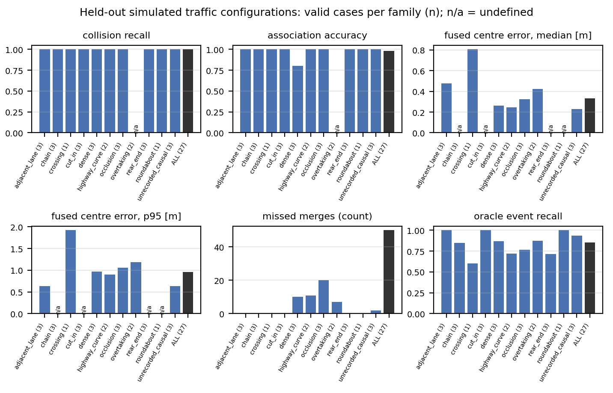

# Frozen robustness and generalization campaign: report

Campaign of 2026-10-15/16 on the frozen reconstruction (protocol: [FROZEN_CAMPAIGN.md](FROZEN_CAMPAIGN.md)).
Detailed tables: `results/robustness/frozen_campaign/report/tables.md` (all 39 conditions, distance bands, incident
participants, GNSS x radar interaction), `results/generalization/frozen_campaign/tables.md` (32 held-out cases);
machine-readable: `summary.json`, `conditions.csv`, `interaction.csv`, `resources.csv`, `cases.csv`, `families.csv`;
every job: `results/robustness/frozen_campaign/jobs.jsonl.gz`.  All results are simulated (CARLA 0.9.15) and the
sensor perturbations are engineering models (`docs/robustness_profiles.md`): they establish the operating envelope
of the method on simulated data, not real-world sensor performance.

## 1. S07 turn indicators

A started already circulating, so the run now begins 9.0 s earlier: A on the straight west approach (the only entry
upstream of its old start), B 72 m further back on its straight south approach.  Conflict and A-B contact happen at
the same instant + 9.0 s; trajectories within 1.3 m (A) and 0.42 m (B) of the earlier recording.  Verified events
(local time = scenario time - 0.05 s, equal to the `lights.jsonl` transitions):

| recorder | event | time | relation to the manoeuvre |
|---|---|--:|---|
| A | INDICATOR_LEFT_START | 0.95 s | before the entry curve (3.25 s) and the circulation (TURN_LEFT_START 6.35 s) |
| A | no END | - | still circulating with the light on at the contact (19.25 s): never switched off |
| B | INDICATOR_RIGHT_START | 12.95 s | before TURN_RIGHT_START 16.90 s |
| B | INDICATOR_RIGHT_END | 19.05 s | after TURN_RIGHT_END 18.95 s, 0.2 s before the contact |

## 2. S08 turn indicator

A signals left from 0.45 s (INDICATOR_LEFT_START), before STOP_SIGN_DETECTED_START (1.15 s); the left turn
(3.70 s) ends in the collision (5.40 s) with the light still on: no END.  Rolling stop, B's trajectory and the A-B
contact are unchanged (trajectories within 0.07 m).  The runner no longer extends a recording for an indicator left on.

## 3. Final canonical validation (22 runs, S01..S19)

13 PASS, 9 WARN, 0 FAIL (`docs/CANONICAL_VALIDATION.md`).  The warnings are conservative missed merges of distant
anonymous vehicles (S14-S19), the audit's ground-truth cut-in heuristic on the S07 roundabout merge and S14, one
missed recorder link (S06) and three track losses while the radar still saw the body (S06, S10).  The frozen
baseline reproduces every canonical global graph node for node (22/22) with single-threaded BLAS.  Full test suite:
599 passed before the freeze.

## 4. Frozen version

| tag | commit | content |
|---|---|---|
| `pre-robustness-campaign` | 5d7adf76 | frozen reconstruction (code 0xac2cb70a, configuration 0xaf2b7dc7), protocol, profiles, held-out cases |
| `robustness-campaign-v2` | 27f9c658 | evaluation defect fixed (closure check on a collision without global time crashed one job; further evaluations isolated) |
| `robustness-campaign-v2.1` | 57611734 | campaign controller only (load measurement, adoption of running jobs) |
| `robustness-campaign-v2.2` | 143667f7 | campaign controller only (persistent concurrency setting) |

Reconstruction code, configuration, profiles, seeds and matrix are those of the freeze in every version
(`results/frozen_campaign_manifest.json`; every job records its commit).  Jobs per commit: 254 (v1, all complete and
identical under v2), 86 (v2), 69 (v2.1), 3453 (v2.2).

## 5. Experiment matrix and execution

3862 jobs (2190 initial, the rest adaptive seeds), 3863 attempts: **0 failed**, 1 v1 failure (the defect above)
re-run complete under v2, 0 partial evaluations.  Seeds: 3 at least, more while the standard error over seeds of a
pooled metric exceeded its tolerance, 8 at most.  Every condition with consumer or degraded GNSS reached 8 seeds: the
0.05 m tolerance on the fused centre error is unreachable when the GNSS error itself is metres (a protocol
limitation, kept unchanged during the campaign).  radar high reached 4 seeds; all others stopped at 3.

## 6. Radar degradation (per detection: range / angle / Doppler sigma, missed detections, false returns per sweep)

low = 0.10 m / 0.1 deg / 0.03 m/s, 5 %, 1; nominal = 0.25 m / 0.5 deg / 0.10 m/s, 20 %, 3; high = 0.50 m / 2 deg /
0.20 m/s, 40 %, 30 (with CARLA's ~75 rays per sweep, about 40 % of the points are false).

| radar | contacts identified | association acc. | wrong / missed links | false merges | phantom entities | centre error median / p95 [m] | events preserved | incident link acc. |
|---|--:|--:|--:|--:|--:|--:|--:|--:|
| none (baseline) | 1.000 | 1.000 | 0 / 1 | 0 | 0 | 0.27 / 0.75 | 1.000 | 0.979 |
| low | 1.000 | 1.000 | 0 / 0.7 | 0 | 1 | 0.28 / 0.74 | 0.993 | 0.986 |
| nominal | 1.000 | 1.000 | 0 / 1.3 | 0.7 | 14 | 0.30 / 0.83 | 0.971 | 0.973 |
| high | 0.991 | 0.950 | 1.5 / 39 | 16.5 | 2252 | 0.52 / 2.05 | 0.854 | 0.576 |

(counts per seed summed over the 22 runs; mean over seeds.)  Low and nominal radar noise cost almost nothing.  High
noise is the breaking point: clutter becomes about 100 phantom road users per run, recorder links of the incident
participants are lost (0.58: left anonymous, never wrong), false merges appear mostly within 10 m, and 15 % of the
core events change.  Collisions are still found with their participants (one missed contact in 88 runs).

## 7. GNSS degradation (absolute / pairwise relative position RMS injected)

| GNSS | abs / rel RMS [m] | contacts | association acc. | missed links | false merges | centre error median / p95 [m] | runs aligned | incident link acc. |
|---|--:|--:|--:|--:|--:|--:|--:|--:|
| RTK | 0.02 / 0.03 | 1.000 | 1.000 | 1.0 | 0 | 0.30 / 0.75 | 1.000 | 0.979 |
| consumer | 2.5 / 3.2 | 1.000 | 1.000 | 6.2 | 0 | 1.78 / 2.58 | 0.972 | 0.930 |
| degraded | 6.9 / 9.4 | 1.000 | 1.000 | 7.9 | 0 | 4.90 / 7.17 | 0.960 | 0.894 |

GNSS errors move the fused road users by about the GNSS error (absolute frame) but create no wrong identity: the
method links fewer tracks (missed links, missed merges) instead.  `gnss_refined` (mutual pose refinement forced on)
gives identical results: the frozen method already refines whenever a pose source declares an uncertainty, so this
ablation is not informative in this study.

## 8. Correlated GNSS (consumer, common fraction rho)

| rho | abs / rel RMS [m] | centre error median [m] | missed links | incident link acc. |
|---|--:|--:|--:|--:|
| 0.5 | 2.11 / 2.24 | 1.63 | 6.2 | 0.930 |
| 0.9 | 1.92 / 1.01 | 2.05 | 5.9 | 0.938 |
| 1.0 | 1.73 / 0.08 | 2.24 | 7.2 | 0.911 |

A common error cancels between recorders (relative error 0.08 m at rho = 1) but not in the map: the fused centre
error stays about the absolute error.  Identity decisions barely change with rho.

## 9. Combined GNSS and radar degradation


Mean +- SD over seeds (3 for RTK, 8 otherwise).  Collisions are reconstructed with their participants in every cell
except radar high (0.986-0.988), never with wrong participants.  The fused centre error follows the GNSS (0.3 / 1.8 /
4.9 m with low or nominal radar), association accuracy follows the radar (0.91-0.94 with high radar), and event
preservation degrades with both (0.75 with degraded GNSS and high radar).

Paired comparison per run and seed (same radar and GNSS draws as the single-sensor jobs; interaction I = C - R - G + B,
95 % bootstrap interval over runs; `interaction.csv`):

- RTK adds nothing measurable to any radar level (interaction 0 for every count).
- With consumer or degraded GNSS and **high radar**, the combination is worse than additive for missed links
  (I = +0.56 and +0.81 per run, intervals [0.16, 0.89] and [0.51, 1.07]) and for lost core events (+0.38, +0.63),
  and **better** than additive for false merges (-0.24, -0.64): with both degraded the method withholds decisions
  (more tracks left anonymous) rather than merging the wrong vehicles.  Consumer GNSS with nominal radar shows the
  same missed-link interaction, smaller (+0.15).
- No interaction for wrong links, association errors, missed contacts or the centre error.
- Caveat: the noise streams are keyed by seed, sensor, profile and recorder name, not by run, so one seed is one
  realization shared by all runs (e.g. the same GNSS bias for "A" in every run).  Runs within a seed are therefore not
  independent and the bootstrap intervals over runs are optimistic for GNSS-driven metrics.  The direction of the
  effects is consistent across seeds; their exact size should be confirmed with run-keyed streams.

## 10. GNSS + collision impulse noise (`combined`, kept separate)

Exact or RTK GNSS with 10 % impulse noise: identical to the baseline.  Consumer GNSS (independent or rho 0.9) with
10 % impulse noise: contacts identified 0.903 +- 0.275 over 8 seeds, entirely due to seed 3, whose first impulse
reports of A and B (x 1.151 and x 0.702) differ by 3.3 sigma, beyond the method's 3-sigma pairing gate, in every run
(the shared-realization caveat above); the other 7 seeds are perfect.  Impulse noise alone: 2-10 % no effect, 20 %
one missed contact in 66 runs.

## 11. Timing, sampling and outages

| condition | contacts | runs aligned | events preserved | note |
|---|--:|--:|--:|---|
| latency 0.05 / 0.10 / 0.25 / 0.50 s (one recorder) | 1.000 / 0.926 / 0.815 / 0.518 | 1 / 1 / 1 / 0.82 | 1.000 / 0.989 / 0.968 / 0.839 | report delays above ~0.1 s break collision pairing |
| clock offsets (+-7 to 29 s) | n/a | - | 1.000 | 19/22 graphs identical node for node |
| 10 Hz / 5 Hz sampling | 1.000 / 0.889 | 1 / 1 | 0.930 / 0.855 | 1 wrong link each; 5 Hz relative clock error up to 3.2 s |
| one recorder missing (50) | 0.954 | 0.98 | 0.959 | contacts of the remaining recorders |
| 1 s radar outage (50) | 1.000 | 1 | 0.941 | 2 wrong links, 2 false merges |

## 12. Collision associations

Over all 3862 jobs no reconstructed collision paired the wrong vehicles (`wrong_collision_matches` 0 in every
condition).  Failures are missed contacts only: radar high (about 1 %), report latency >= 0.10 s, 5 Hz sampling,
missing recorder, and the seed-3 impulse realization with consumer GNSS.

## 13. Fusion near the incident

Incident participants (true contact partners) are never linked to the wrong recorder in any condition (wrong 0).
Under degradation their links are lost instead (incident link accuracy 0.98 baseline, 0.93 consumer GNSS, 0.58 radar
high, 0.31-0.39 GNSS x high radar).  By distance (baseline -> radar high): association accuracy 1.00 -> 0.98 within
10 m, false merges 0 -> 11 per seed within 10 m and 0 -> 0.5 beyond 25 m; with GNSS errors the bands do not change
(no false merges at any range).

## 14. Absolute trajectory errors (fused anonymous road users)

Baseline: median 0.27 m, p95 0.75 m, max 3.1 m; velocity median 0.11 m/s.  Radar high: 0.52 / 2.05 / 6.1 m.
Consumer GNSS: 1.78 / 2.58 / 5.6 m; degraded GNSS: 4.90 / 7.17 / 22.5 m (0.41 m/s).  By band the baseline error grows
with range (0.17 / 0.25 / 0.52 m for 0-10 / 10-25 / > 25 m).

## 15. Held-out simulated traffic configurations

32 predeclared cases in 11 families (new blueprints, separations, speeds, timing, collision and non-collision), one
recording each on the private engine, evaluated without any change to the method:

- 27 physically valid, 5 invalid by the predeclared on-lane rule (H07, H08 left the roadway after a no-contact
  crossing; H10, H11, H30 grazed a lane edge by 1-6 cm, as canonical S07 and S19 also do); 5 outcomes differed from
  the intended one (H01, H07, H28 without contact; H16 hit the occluding truck; H24 an extra contact): all kept.
- On the 27 valid cases: 23/23 contacts identified, 0 wrong collision matches, association accuracy 0.979 (1 wrong
  link: H26, dense platoon, B's identity put on a nearby car's track by the collision association), 0 false merges,
  50 missed merges, fused centre error median 0.33 m (p95 0.95 m), 0 EGO_PATH oscillations, 0 closure violations,
  CUT_IN recall 0.67 against the audit's ground-truth heuristic, oracle event recall 0.85.
- Without a collision the recorders of three runs were not aligned (H28, H29, H31: their mutual tracks stay anonymous).



## 16. Computational cost

173 CPU-hours for the campaign (per job: median 39-126 s, p95 up to 913 s for GNSS x high radar), worker peak memory
at most 427 MB, perturbed copies deleted after each job (disk stable).  Single-threaded BLAS per job, verified
node-for-node identical to the canonical outputs and about twice as fast as multi-threaded.  Concurrency 8-24 workers
(adaptive, then fixed at 20 and 24 on request); the campaign paused once (15:55-18:36) and resumed without
repeating any job.

## 17. Main failure conditions and limitations

1. Dense radar clutter (30 false returns per sweep): phantom road users, lost recorder links (including incident
   participants), false merges close to the recorder.
2. Collision report delays of 0.1 s or more, or impulse reports differing by more than 3 sigma: contacts left
   unpaired (never wrongly paired).
3. GNSS errors of metres: the fused map position is off by about the GNSS error; identities are withheld, not wrong.
4. 5 Hz sampling: 11 % of contacts lost.
5. Distant road users (> 25 m) often stay as several anonymous fragments (missed merges), by design.
6. Evaluation: noise streams shared by all runs of a seed (see 9); `gnss_refined` not an informative ablation; the
   seed-stopping tolerance on the centre error is too tight for GNSS-scale errors; the audit's cut-in truth is a
   heuristic; the on-lane acceptance rule is stricter than CARLA's controller on curves.

## 18. Reproduction

```bat
git checkout robustness-campaign-v2.2
python scripts\campaign_controller.py workers 20
python scripts\campaign_controller.py start
python scripts\campaign_controller.py status
python scripts\campaign_report.py robustness
python scripts\generalization.py check & python scripts\generalization.py record & python scripts\generalization.py evaluate
python scripts\campaign_report.py generalization
```

Every job verifies the frozen commit and a clean tree (`CDF_ANALYSIS_FREEZE_COMMIT`); the held-out recordings need
the private CARLA engine on port 3000 (`heldout/frozen_campaign/`, not committed).

## 19. Output paths

- `results/robustness/frozen_campaign/report/` (tables, csv, json, `figures/*.pdf|svg|png`: degradation curves per
  family, GNSS x radar curves and heatmap), `jobs.jsonl.gz`, `control/` (controller log, 15-min resource monitor).
- `results/robustness/frozen_campaign_smoke/` (smoke test).
- `results/generalization/frozen_campaign/` (protocol checks, recordings, jobs, tables, figure).
- `results/frozen_campaign_manifest.json`, `docs/FROZEN_CAMPAIGN.md`.
