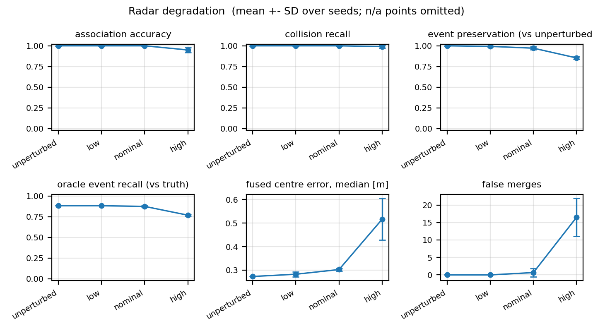
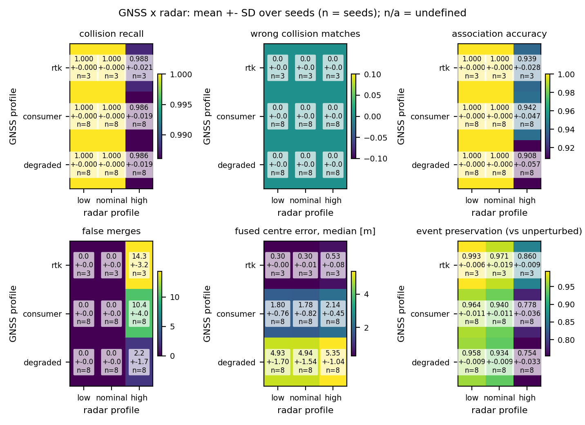

# Robustness of the reconstruction on the 22 canonical runs

> **Historical (archived 2026-10-22).**  Every number below refers to the canonical recordings that preceded the deterministic re-acquisition of 2026-10-22 (Git history before commit `34162ca7`, tag `robustness-campaign-final`), not to the current `traces/`.  Current results: [G0_ERROR_ANALYSIS](../G0_ERROR_ANALYSIS.md); next campaign: [CAMPAIGN_V3](../CAMPAIGN_V3.md).


Report of the robustness campaign of 2026-10-15/16 (protocol: [FROZEN_CAMPAIGN.md](FROZEN_CAMPAIGN.md); perturbation
profiles: [robustness_profiles.md](../robustness_profiles.md)).  Every number below is computed by
`scripts/campaign_report.py` from the job records `results/robustness/frozen_campaign/jobs.jsonl.gz`; the full tables
(all 35 conditions, distance bands, incident participants, GNSS x radar interaction) are in
`results/robustness/frozen_campaign/report/tables.md`, the machine-readable values in `report/summary.json`,
`conditions.csv`, `interaction.csv` and `resources.csv`, the figures in `report/figures/`.

## 1. Objective

To establish the operating envelope of the frozen reconstruction when the onboard recordings are worse than
CARLA's: noisier radar with missed detections and clutter, GNSS pose errors (independent or correlated between
recorders), both together, uncertain collision impulse reports, unsynchronised recorder clocks, a lower sampling
rate, a missing recorder and short radar outages.  The question is which parts of the reconstruction (collisions,
recorder identities, anonymous road users, trajectories, semantic events) survive and how they fail.  The
perturbations are engineering models of sensor errors applied to simulated data: the results describe the method on
CARLA recordings, not the performance of a real radar or receiver.

## 2. Dataset

The 22 canonical runs of the 19 scenarios S01-S19 (`scripts/validate_canonical.py`, `docs/CANONICAL_VALIDATION.md`):
rear-end, cut-in, crossings, chains, occlusion, a non-recording causal vehicle, a roundabout, stop-controlled
junctions, dense traffic, overtaking and a motorway curve, 2-3 recording vehicles each and up to 8 non-recording
road users.  Every run was reviewed manually in the replay; 27 true vehicle-vehicle contacts in all.  Ground truth
(`ground_truth/`) is read by the evaluation only.

## 3. Frozen reconstruction method

The single reconstruction method of the repository (radar tracking per recorder, alignment on shared collisions or
observed trajectories, identity association of local tracks with recorders, fusion of the anonymous road users,
global semantic graph; README and `docs/event_definitions.md`), frozen with its configuration before the campaign
(tag `pre-robustness-campaign`).  The reconstruction sources and configuration are those of that tag in every job
(the hashes are in `results/robustness_campaign_manifest.json`).  The unperturbed baseline reproduces every
canonical global graph node for node (22/22).

## 4. Experimental methodology

For each condition and run a perturbed copy of the run is written (radar, collision and clock perturbations in the
files; GNSS errors through the pose source), the frozen reconstruction runs on it, and the evaluation compares the
result with ground truth and with the unperturbed reconstruction.  35 conditions in 12 families; stochastic
conditions run seeds 0, 1, 2 and further seeds (at most 8) while the standard error over seeds of a pooled metric
exceeds its tolerance; deterministic ones run once.  3,774 jobs, all complete (3,775 attempts: one job failed under
the first version because of an evaluation defect and completed after its correction, see the protocol).

Aggregation: per condition and seed the counts are summed over the 22 runs; the tables give the mean over seeds
+- the standard deviation over seeds.  Metrics (counts are per seed over all 22 runs unless stated):

- **true contacts**: vehicle-vehicle contacts in ground truth (27 per seed);
- **contacts identified** (collision recall): true contacts reconstructed as a collision node with exactly their
  participants; **contacts detected**: with a collision node, participants right or not;
- **missed contact**: a true contact without any reconstructed collision; **wrong collision match**: a
  reconstructed collision with the wrong participants or between vehicles that did not touch;
- **recorder links**: a local track of another recorder linked to that recorder: **correct**, **wrong** (linked to
  the wrong recorder) or **missed** (left anonymous although it is a recorder);
- **association accuracy** = correct / (correct + wrong) over the *decided* associations only: tracks left anonymous
  are not in its denominator and are counted as missed links;
- **false merge**: two tracks of different vehicles fused into one anonymous road user; **missed merge**: two tracks
  of one vehicle left as separate road users; **phantom entity**: an anonymous road user on no true vehicle;
  **duplicate hypotheses**: extra entities for one true vehicle;
- **trajectory errors**: distance between a fused anonymous road user's state and its true vehicle (centre, m;
  velocity, m/s), per-run median and p95, then median over runs; max over runs;
- **incident participants**: the vehicles of the true contacts; **incident link accuracy** = correct / (correct +
  wrong + missed) recorder links of tracks on them;
- **distance bands**: a track's median radar range (0-10, 10-25, > 25 m);
- **event preservation**: core events of the unperturbed reconstruction found again (stability against the
  baseline, not accuracy); **oracle event recall / precision**: agreement with the ground-truth coverage oracle;
- **EGO_PATH oscillations**: entry / exit undone within three sweeps (stability audit).

## 5. Radar robustness

Per detection: range / azimuth and elevation / radial-velocity sigma, missed-detection probability, false returns per
sweep: low 0.10 m / 0.1 deg / 0.03 m/s, 5 %, 1; nominal 0.25 m / 0.5 deg / 0.10 m/s, 20 %, 3; high 0.50 m / 2 deg /
0.20 m/s, 40 %, 30 (CARLA casts about 75 rays per sweep, so about 40 % of the points are false at high).

| radar | contacts identified | association acc. | wrong / missed links | false merges | phantom entities | centre error median / p95 [m] | event preservation | incident link acc. |
|---|--:|--:|--:|--:|--:|--:|--:|--:|
| none | 1.000 | 1.000 | 0 / 1 | 0 | 0 | 0.27 / 0.75 | 1.000 | 0.979 |
| low | 1.000 | 1.000 | 0 / 0.7 | 0 | 1 | 0.28 / 0.74 | 0.993 | 0.986 |
| nominal | 1.000 | 1.000 | 0 / 1.3 | 0.7 | 14 | 0.30 / 0.83 | 0.971 | 0.973 |
| high | 0.991 +- 0.018 | 0.950 +- 0.031 | 1.5 / 39 | 16.5 | 2252 | 0.52 / 2.05 | 0.854 | 0.576 |

Low and nominal radar noise leave the reconstruction practically unchanged.  High noise is the breaking point:
clutter becomes about 100 phantom road users per run, 42 % of the recorder links on incident participants are lost
(left anonymous, never wrong), false merges appear mostly within 10 m of the recorder (11 of 16.5), and 15 % of the
core events change.  Collisions are still reconstructed with their participants except about one in a hundred.


## 6. GNSS robustness

| GNSS | injected absolute / relative error RMS [m] | contacts | association acc. | missed links | false merges | centre error median / p95 [m] | runs aligned | incident link acc. |
|---|--:|--:|--:|--:|--:|--:|--:|--:|
| RTK | 0.02 / 0.03 | 1.000 | 1.000 | 1.0 | 0 | 0.30 / 0.75 | 1.000 | 0.979 |
| consumer | 2.5 / 3.2 | 1.000 | 1.000 | 6.2 | 0 | 1.78 / 2.58 | 0.972 | 0.930 |
| degraded | 6.9 / 9.4 | 1.000 | 1.000 | 7.9 | 0 | 4.90 / 7.17 | 0.960 | 0.894 |

A GNSS error moves the fused road users by about the error itself (absolute map frame) but creates no wrong
identity and no false merge: the method decides less (missed links and merges) instead of deciding wrongly.
Collisions are all reconstructed; 3-4 % of the runs lose the alignment of a recorder.

## 7. Correlated GNSS

Consumer receivers whose slow error is shared between recorders with fraction rho:

| rho | absolute / relative RMS [m] | centre error median [m] | missed links | incident link acc. |
|---|--:|--:|--:|--:|
| 0.5 | 2.11 / 2.24 | 1.63 | 6.2 | 0.930 |
| 0.9 | 1.92 / 1.01 | 2.05 | 5.9 | 0.938 |
| 1.0 | 1.73 / 0.08 | 2.24 | 7.2 | 0.911 |

A common error cancels between recorders (0.08 m relative at rho = 1) but not in the map: the fused position stays
off by about the absolute error.  Identity decisions barely depend on rho.

## 8. GNSS refinement ablation

`gnss_refined` forces the mutual refinement of the pose sources on.  Its results are identical to `gnss` at every
level: the frozen method already refines the pose sources whenever they declare a position uncertainty, which every
perturbed GNSS profile does, so the flag changes nothing in this study.  The ablation is therefore not informative;
it is reported for completeness.

## 9. Combined GNSS + radar degradation



Mean +- SD over seeds (3 with RTK, 8 otherwise).  Collisions are reconstructed with their participants in every cell
except high radar (0.986-0.988) and never with wrong participants.  The fused position error follows the GNSS (0.3 /
1.8 / 4.9 m with low or nominal radar), association accuracy follows the radar (0.91-0.94 with high radar), event
preservation degrades with both (0.75 with degraded GNSS and high radar).

Paired comparison per run and seed (the combined jobs draw the same radar and GNSS errors as the single-sensor jobs;
interaction I = C - R - G + B, mean over runs, 95 % bootstrap interval over runs; `report/interaction.csv`):

- RTK adds nothing measurable to any radar level;
- with consumer or degraded GNSS and high radar the combination is worse than additive for missed links (+0.56 and
  +0.81 per run, intervals [0.16, 0.89] and [0.51, 1.07]) and lost core events (+0.38, +0.63), and better than
  additive for false merges (-0.24, -0.64): with both degraded the method withholds decisions rather than merging
  wrong vehicles; consumer GNSS with nominal radar shows the same missed-link interaction, smaller (+0.15);
- no interaction for wrong links, association errors, missed contacts or the position error.

The intervals treat runs as independent although the runs of one seed share one noise realization (section 19):
they are optimistic for GNSS-driven metrics.

## 10. Collision impulse uncertainty

Each impulse report is multiplied by 1 + N(0, eps^2), independently per recorder; the method pairs two reports when
their impulses agree within 3 sigma of an assumed 10 % relative error.  eps = 2, 5, 10 %: no effect; 20 %: one missed
contact in 66 runs.  Combined with GNSS (`combined`): exact or RTK GNSS + 10 %: identical to the baseline; consumer
GNSS + 10 % (independent or rho 0.9): contacts identified 0.903 +- 0.275 over 8 seeds, entirely due to seed 3, whose
first impulse reports of A and B (x 1.151 and x 0.702) differ by 3.3 sigma, beyond the pairing gate, in every run;
the other seven seeds are perfect.  Reports outside the gate are left unpaired, never paired wrongly.

## 11. Whole-recorder clock offsets

Every timestamp of each recorder shifted by a constant (+7.3, -14.6, +21.9 s, ...; no drift).  The core events are
identical (preservation 1.000, time differences 0) and 19 of the 22 global graphs are identical node for node; the
other three differ only outside the core events.  Correctness metrics are not computed here, because the shifted raw clocks
invalidate the ground-truth time mapping.

## 12. Reduced sampling frequency

| rate | contacts identified | association acc. | wrong links | event preservation | largest relative clock error |
|---|--:|--:|--:|--:|--:|
| 10 Hz | 1.000 | 0.980 | 1 | 0.930 | 0.05 s |
| 5 Hz | 0.889 | 0.980 | 1 | 0.855 | 3.15 s |

At 5 Hz three of the 27 contacts are not paired and one recorder's clock is placed 3 s off.

## 13. Missing recorder

Each recorder of the multi-recorder runs removed in turn (50 jobs): contacts identified 0.954 (contacts of the
remaining recorders), runs aligned 0.98, association accuracy 1.000, no false merge, event preservation 0.959.

## 14. Temporary radar outages

1 s without radar on one recorder, 1-2 s before its first collision (50 jobs): all contacts identified, association
accuracy 0.984 (2 wrong links), 2 false merges, 9 missed links, event preservation 0.941.

## 15. Collision reconstruction accuracy

Over all 3,774 jobs no reconstructed collision paired the wrong vehicles and no collision was reconstructed between
vehicles that did not touch (wrong collision matches 0 in every condition).  Failures are missed contacts only: high
radar (about 1 %), 5 Hz sampling (11 %), a missing recorder (5 %), the seed-3 impulse realization with consumer GNSS,
20 % impulse noise (1 in 66 runs).

## 16. Vehicle identity and fusion accuracy

- Recorder links: wrong links occur only with high radar (1-2 per seed over 22 runs), 10 / 5 Hz sampling (1) and radar
  outages (2); GNSS errors of any size produce none.
- Incident participants are never linked to the wrong recorder; their links are lost instead (incident link
  accuracy 0.98 baseline, 0.93 consumer GNSS, 0.58 high radar, 0.31-0.39 GNSS x high radar).
- False merges: 0 in the baseline and under every GNSS profile; with high radar 16.5 per seed, of which 11 within
  10 m of the recorder.
- Missed merges are the method's conservative choice (43 in the baseline, mostly beyond 25 m) and grow with every
  degradation (139 high radar, 80-110 consumer / degraded GNSS).

## 17. Trajectory accuracy

Fused anonymous road users against their true vehicle: baseline centre error median 0.27 m, p95 0.75 m, max 3.1 m;
by distance 0.17 / 0.25 / 0.52 m (0-10 / 10-25 / > 25 m); velocity median 0.11 m/s (p95 0.65).  High radar: 0.52 /
2.05 / 6.1 m.  Consumer GNSS: 1.78 / 2.58 / 5.6 m; degraded GNSS: 4.90 / 7.17 / 22.5 m (velocity median 0.41 m/s).
Calibration: the share of fused states within their declared 2-sigma is 0.01 in the baseline (median over runs;
0.865 expected for a calibrated Gaussian): the declared uncertainty of the fused states is far too small.

## 18. Semantic event stability

Against the unperturbed reconstruction (stability, not accuracy): core events preserved 1.000 (baseline, clock
offsets, GNSS RTK), 0.97 (nominal radar, consumer GNSS), 0.85 (high radar), 0.75 (degraded GNSS x high radar).  Against
the ground-truth coverage oracle (accuracy of the existing definitions, unchanged by the campaign): recall 0.88 and
precision 0.77 in the baseline; with high radar recall 0.77 and precision 0.06, because the phantom road users produce
events.  EGO_PATH oscillations: 0 in the baseline and under GNSS errors, 3.8 per seed with high radar.  CRITICAL_TTC
closure violations: 0 except 0.4 per seed in the GNSS x radar cells with consumer or degraded GNSS and nominal or high radar.  CUT_IN against the audit's ground-truth heuristic:
0.80 baseline, 0.60 high radar.

## 19. Scientific limitations

- Perturbations are engineering models (Gaussian, per detection or per receiver epoch; uniform clutter; no
  multipath geometry, no NLOS jumps, constant clock offsets); the results describe CARLA recordings.
- Shared seed realizations: the random streams are keyed by seed, sensor, profile and recorder name, not by run, so
  one seed is one realization shared by all 22 runs (for example the same GNSS bias for recorder A in every run, or
  the seed-3 impulse draw that broke the pairing everywhere at once).  Runs within a seed are not independent: the
  effective sample size of GNSS- and impulse-driven metrics is the number of seeds, and the bootstrap intervals over
  runs are optimistic.
- Calibration: the fused states' declared uncertainty is overconfident (section 17).
- The adaptive seed rule's 0.05 m tolerance on the fused centre error cannot be met when the GNSS error is metres:
  every condition with consumer or degraded GNSS ran the maximum 8 seeds.
- `gnss_refined` is not an informative ablation (section 8).
- The audit's ground-truth cut-in is a heuristic (it counts the S07 roundabout merge and the S14 sideswipe as
  cut-ins); event preservation measures stability, not correctness.
- 22 runs of 19 scenarios on three CARLA towns: the envelope is established for these traffic situations only.

## 20. Reproducibility

Inputs: the 22 canonical runs under `traces/<scenario>/<run>/` (raw `vehicles/`, `ground_truth/` for the evaluation,
and the canonical `reconstruction/` the perturbed runs are compared with), Python 3.8 with the conda environment
`carla` (versions in the manifest).  No CARLA server is needed.

```bat
git checkout robustness-campaign-final
set CDF_CAMPAIGN_RESULTS=results\robustness\my_run
scripts\campaign.bat workers 20
scripts\campaign.bat start
scripts\campaign.bat status
python scripts\campaign_report.py robustness --jobs results\robustness\my_run\jobs.jsonl
```

The controller verifies the commit, a clean tree, the code and configuration hashes, the raw data of the 22 runs and
the matrix against `results/robustness_campaign_manifest.json` before any job, runs one process per job with
single-threaded BLAS, and can be paused and resumed (`scripts\campaign.bat pause`, `resume`) without repeating a
completed job.  The committed report is regenerated from the committed records with
`python scripts\campaign_report.py robustness`.  Computational cost of the campaign: 171 CPU-hours, worker peak
memory 427 MB, 20-24 workers on 22 logical CPUs.
